# ZombsRoyale weapons reference

Every gun, special weapon and throwable in ZombsRoyale.io, with in-game pictures, stats and a ranking of the guns. Stats come from the ZombsRoyale.io Fandom wiki, fetched on 2026-10-13. The wiki records no weapon balance changes since May 2022; the only weapons added since then are the Healing and Incendiary Grenades (2024). The pictures are the game's own inventory icons, cut from texture atlases that a wiki editor extracted from the game client in July 2026. Machine-readable data is in [weapons/weapons.json](weapons/weapons.json).

A web search turned up no recent community tier list, so the ranking is a judgement from the wiki's numbers and its strategy notes. Where the two disagree, the numbers win. A ● after a name means the assistant's icon library has learned that item from a pickup prompt in the recorded matches.

## How to read the numbers

- **TTK** (time to kill) is how long a gun takes to deal 200 damage, a full 100 health plus 100 shield, if every shot hits. It uses the best rarity normally found. **Near** is point-blank and **far** is the edge of the gun's range.
- Snipers deal much **less** damage up close, and SMGs, the P90 and the Vector lose most of their damage at range. This is why near and far TTK can differ by several seconds.
- Rarity matters as much as the gun. Each rarity step adds about 1 damage per bullet, about 7% for an AR, so a Legendary gun from a lower tier can beat an Uncommon one from a higher tier.
- Mythic weapons only come from Airdrops, Gold Chests or Zombs crates; the wiki's pages disagree on which. They are rare, but always worth picking up.

## Gun ranking

### S tier: take it over anything

| # | | Gun | Rarity | Where | TTK near / far | Why |
|---|---|---|---|---|---|---|
| 1 | 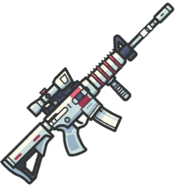 | **Scoped M4** | Mythic | Gold Chests / Zombs crates | 1.1 s / 1.2 s | M4 with more damage and a wider view; the wiki calls the Mythic ARs the best guns in the game. |
| 2 | 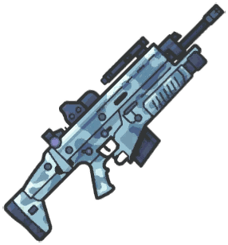 | **Assault SCAR** | Mythic | Gold Chests / Zombs crates | 1.2 s / 1.2 s | Highest AR DPS plus splash; don't use it point-blank, the explosive round hurts you too. |
| 3 | 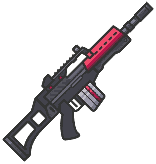 | **MG36** ● | Mythic | Airdrop only | 1.1 s / 1.1 s | Scoped-M4 damage with a 90-round magazine: whole fights without reloading. |
| 4 | 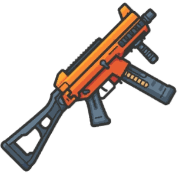 | **UMP** ● | Epic–Legendary | Crates, Gold Chests | 0.8 s / 1.1 s | Best non-Mythic gun: hardest-hitting SMG, kills a full 100/100 player in under a second, still fine at mid range. |
| 5 | 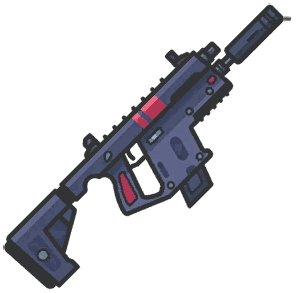 | **Vector** | Mythic | Airdrop only | 0.7 s / 4.8 s | Fastest kill in the game up close (288 DPS); damage collapses at range and the 24-round mag empties in 1 s. |
| 6 | 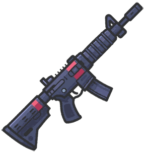 | **M4** ● | Uncommon–Legendary | Floor, crates, chests | 1.3 s / 1.4 s | Best regular AR: highest non-Mythic AR DPS, accurate, steady stream. The wiki's 'ideal mid-range weapon'. |

### A tier: strong, keep it

| # | | Gun | Rarity | Where | TTK near / far | Why |
|---|---|---|---|---|---|---|
| 7 | 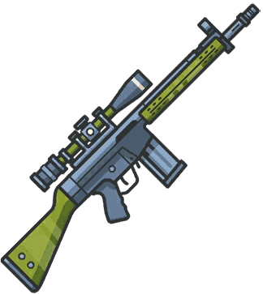 | **Semi-Auto Sniper** ● | Epic–Legendary | Crates, Gold Chests | 3.0 s / 1.0 s | Best long-range DPS in the game (~4 shots/s) and forgiving; weak up close. |
| 8 | 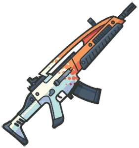 | **XM8** ● | Mythic | Airdrop only | 1.3 s / 1.5 s | Fast bursts, works as a close-to-mid SMG replacement; shorter range than the other Mythic ARs. |
| 9 | 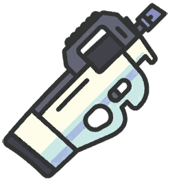 | **P90** ● | Epic–Legendary | Crates, Gold Chests | 0.7 s / 1.8 s | Vector-like shredder inside houses, but very weak beyond close range. |
| 10 | 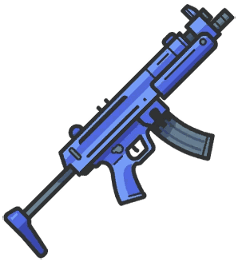 | **MP5** ● | Common–Legendary | Floor, crates, chests | 0.9 s / 1.3 s | Common, accurate, high DPS; a Legendary MP5 beats a Mythic SCAR point-blank. |
| 11 | 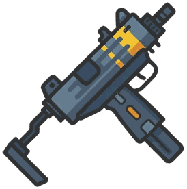 | **Uzi** ● | Common–Legendary | Floor, crates, chests | 0.9 s / 1.1 s | MP5 damage in bursts; slightly better at range than the MP5, smaller magazine. |
| 12 | 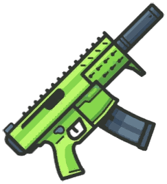 | **Silenced SMG** | Rare–Epic | Floor, Gold Chests | 0.9 s / 1.3 s | Epic MP5 numbers with less noise and better accuracy than most SMGs. |
| 13 | 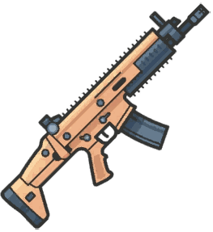 | **SCAR** ● | Uncommon–Legendary | Floor, crates, chests | 1.4 s / 1.6 s | Hard-hitting, accurate auto (buffed in season 19); smaller magazine and slow reload. |
| 14 | 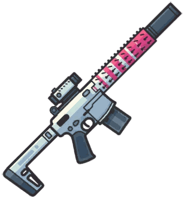 | **Silenced AR-15** | Mythic | Gold Chests / Zombs crates | 1.4 s / 1.6 s | Quiet, long range, 1 s reload; DPS is only a little above a Legendary AR-15. |
| 15 | 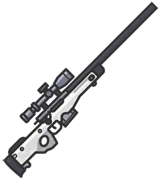 | **AWP** | Mythic | Airdrop only | >6 s / 2.0 s | Hardest single hit at range (80) and the widest view; slow follow-ups. |
| 16 | 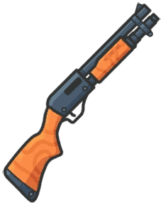 | **Pump Shotgun** ● | Common–Legendary | Floor, crates, chests | 1.0 s / — | Highest damage per shot in the game; two point-blank hits kill. A full reload takes ~6 s. |
| 17 | 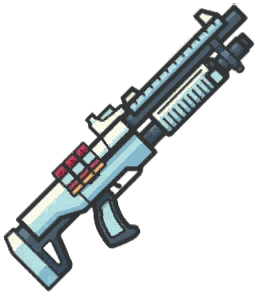 | **Assault Shotgun** | Rare–Epic | Floor, crates, chests | 0.8 s / — | Fast, tight-spread shotgun; better than the Pump outdoors and at close-mid range. |
| 18 | 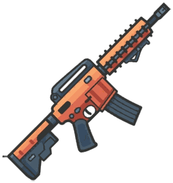 | **AR-15** ● | Uncommon–Legendary | Floor, crates, chests | 1.7 s / 2.0 s | Longest-reaching regular AR, fast bullets with knockback; easy to use but lower damage. |
| 19 | 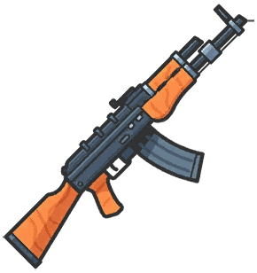 | **AK** ● | Uncommon–Legendary (Mythic in Zombs crates) | Floor, crates, chests | 1.7 s / 1.8 s | Most damage per bullet of any AR but the lowest AR DPS; rewards landing whole bursts. |
| 20 | 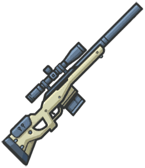 | **Bolt Mk. II Sniper** ● | Uncommon–Legendary | Crates, Gold Chests | >6 s / 2.0 s | Three hits at range kill; huge damage drop-off up close and slows you down. |

### B tier: good or situational

| # | | Gun | Rarity | Where | TTK near / far | Why |
|---|---|---|---|---|---|---|
| 21 | 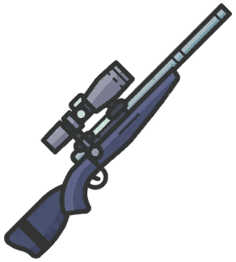 | **Bolt-Action Sniper** | Uncommon–Epic | Floor, crates, chests | >6 s / 2.0 s | Classic bolt sniper; tops out at Epic in normal games, so slightly weaker than the Mk. II. |
| 22 | 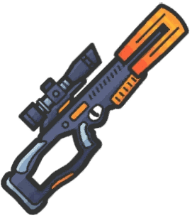 | **XBow** | Mythic | Airdrop only | 2 shots (~1.6 s) | Two 65-damage arrows per shot with AWP-level view; slow arrows need leading. |
| 23 | 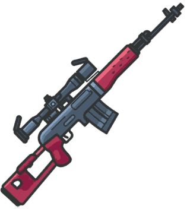 | **Dragunov** ● | Mythic | Gold Chests / Zombs crates | >6 s / 3.4 s | Big knockback and fast bullets, but a 1-round magazine. |
| 24 | 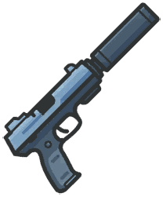 | **Silenced Pistol** ● | Rare–Epic | Floor, crates, chests | 1.3 s / 1.3 s | No spread and no damage drop-off, plus the fastest movement of any gun class. |
| 25 | 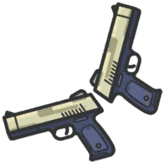 | **Dual Berettas** ● | Uncommon–Rare | Floor, crates, chests | 1.3 s / 1.3 s | No spread and a very high fire rate; strong early-game gun. |
| 26 | 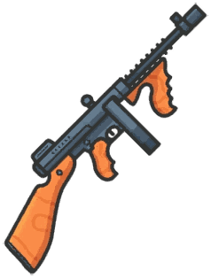 | **Tommy Gun** | Rare–Epic | Crates, chests | 1.4 s / 2.8 s | 50-round drum, but it uses medium (AR) ammo and falls off hard at range. |
| 27 | 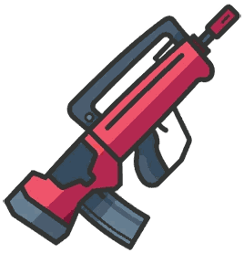 | **Famas** ● | Rare–Epic | Crates, Gold Chests | 1.8 s / 2.0 s | Quick burst rifle, but the slowest-killing AR and a 2.1 s reload. |
| 28 | 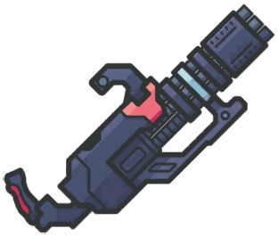 | **Minigun** | Legendary | Crates, Gold Chests | 1.0 s / 1.7 s | Huge magazine and DPS on paper, but heavy spread, spin-up and it slows you a lot. |
| 29 | 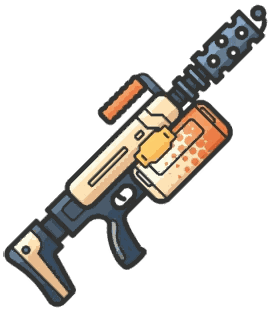 | **Flamethrower** | Legendary | Crates, Gold Chests | ~0.8 s point-blank | Melts anyone in reach and keeps burning them; useless past short range. |
| 30 | 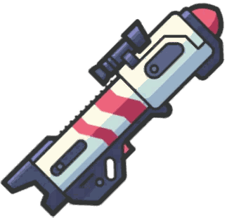 | **RPG** ● | Uncommon–Legendary | Floor, crates, chests | 3 hits | Huge splash for houses and groups; slow rocket, and it can blow you up. |
| 31 | 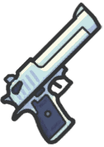 | **Deagle** ● | Rare–Epic | Floor, crates, chests | 2.0 s / 2.0 s | Sniper-like hand cannon (41 per hit, 2 shots/s); punishing if you miss. Uses large ammo. |
| 32 | 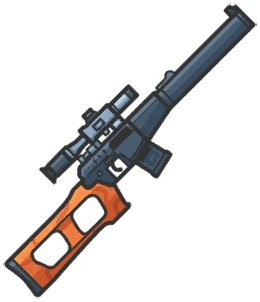 | **VSS** ● | Rare–Legendary | Floor, crates, chests | 3.1 s / 3.5 s | Only automatic sniper; easy and decent up close, but low damage. Uses SMG (small) ammo. |
| 33 | 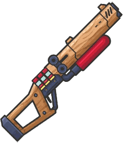 | **RAID Shotgun** | Common–Epic | Floor, crates, chests | 1 fully charged hit | Charge it fully for up to 200 in one shot; weak uncharged and the slowest shotgun to reload. |
| 34 | 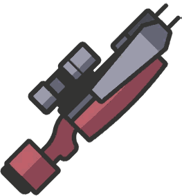 | **Crossbow** | Mythic | Gold Chests / Zombs crates | 3 hits (~3.2 s) | One-shot-per-reload bow with a huge view; arrows are slow. |

### C tier: replace when you can

| # | | Gun | Rarity | Where | TTK near / far | Why |
|---|---|---|---|---|---|---|
| 35 | 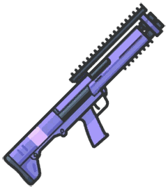 | **KSG Shotgun** ● | Rare–Epic | Floor, crates, chests | 1.0 s / — | Low damage per shot and no knockback; pellets pass through players. |
| 36 | 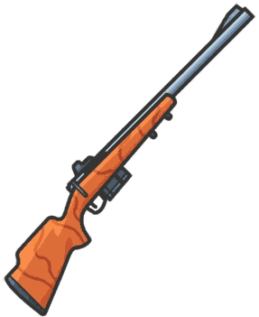 | **Hunting Rifle** | Common–Epic | Floor, crates, chests | >6 s / 3.0 s | Budget sniper: 4 quick shots, then a slow round-by-round reload. |
| 37 | 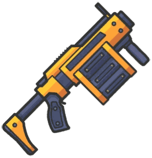 | **Grenade Launcher** | Legendary | Crates, Gold Chests | 8 hits (~3.5 s) | Flushes people out of houses; low damage per grenade. |
| 38 | 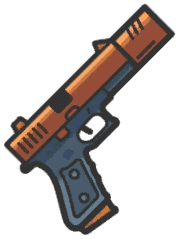 | **Glock** ● | Common–Uncommon | Floor, crates, chests | 2.6 s / 2.6 s | Early-game stopgap; 15-round magazine forces a reload before a full kill. |
| 39 | 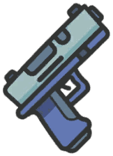 | **P2000** | Common–Uncommon | Floor, crates, chests | 2.7 s / 2.7 s | Weakest gun in normal loot; swap it out as soon as possible. |
| 40 | 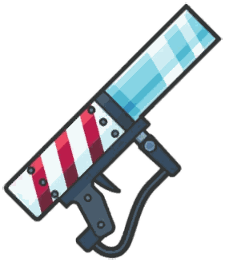 | **Gift Launcher** | Legendary | Holiday seasons | — | Seasonal novelty; sticky explosives, splash. |
| 41 | 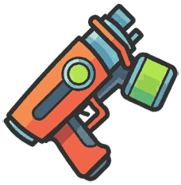 | **Goo Gun** | Legendary | Crates, Gold Chests | — | Damage over time for hit-and-run; needs a real gun to finish. |
| 42 | 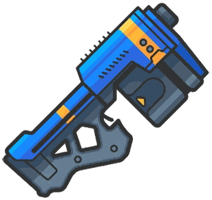 | **Rubber Gun** | Legendary | Crates, Gold Chests | — | Bounces off walls, hitting harder per bounce; situational. |

## Best gun for each slot

You usually carry one close-range gun, one mid-range gun and one long-range gun. Within each slot, the best first:

- **Close range (SMG or shotgun):** UMP > Vector > P90 > MP5 > Uzi > Silenced SMG > Pump Shotgun > Assault Shotgun > Silenced Pistol > Dual Berettas > Tommy Gun > Flamethrower > RAID Shotgun > KSG Shotgun > Glock > P2000
- **Mid range (assault rifle):** Scoped M4 > Assault SCAR > MG36 > M4 > XM8 > SCAR > Silenced AR-15 > AR-15 > AK > Famas > Minigun
- **Long range (sniper):** Semi-Auto Sniper > AWP > Bolt Mk. II Sniper > Bolt-Action Sniper > XBow > Dragunov > Deagle > VSS > Crossbow > Hunting Rifle

The Semi-Auto Sniper is ranked above the AWP because it fires about four times as often, which forgives misses and makes it the fastest killer at long range. The AWP still hits harder per shot.

## Stats by class

Damage and DPS are at the best rarity normally found. A range such as 10–15 is the damage at the far and near ends of the gun's range; for snipers the higher number is the far end. Range and spread words are the wiki's.

### Assault rifles

| | Gun | Fire | Damage | DPS | Mag | Reload | Range | Ammo |
|---|---|---|---|---|---|---|---|---|
|  | **Scoped M4** | Auto | 16–17 | 160–170 | 30 | 1.5 s | Long+ | Medium |
|  | **Assault SCAR** | Auto, every 6th shot explodes (20) | 11–13 | 150–180 | 30 | 1.5 s | Med++ | Medium |
|  | **MG36** ● | Auto | 17 | 170 | 90 | 1.4 s | Med++ | Medium |
|  | **M4** ● | Auto | 14–15 | 140–150 | 30 | 1.4 s | Med++ | Medium |
|  | **XM8** ● | Burst of 4 | 11–12 | 120–144 | 28 | 1.5 s | Long- | Medium |
|  | **SCAR** ● | Auto | 18–19 | 126–133 | 24 | 2 s | Med++ | Medium |
|  | **Silenced AR-15** | Burst of 3, silenced | 14–15 | 117–135 | 30 | 1 s | Long+ | Medium |
|  | **AR-15** ● | Burst of 3 | 11–13 | 99–117 | 30 | 1.4 s | Long- | Medium |
|  | **AK** ● | Burst of 3 | 18–19 | 108–114 | 30 | 1.4 s | Long-- | Medium |
|  | **Famas** ● | Burst | 16–17 | 96–102 | 30 | 2.1 s | Long | Medium |

### SMGs

| | Gun | Fire | Damage | DPS | Mag | Reload | Range | Ammo |
|---|---|---|---|---|---|---|---|---|
|  | **UMP** ● | Auto | 13–17 | 182–238 | 35 | 1 s | Med | Small |
|  | **Vector** | Auto | 3–12 | 72–288 | 24 | 1 s | Med+ | Small |
|  | **P90** ● | Auto | 5–13 | 110–286 | 40 | 1.7 s | Short+ | Small |
|  | **MP5** ● | Auto | 10–15 | 150–225 | 30 | 1 s | Med- | Small |
|  | **Uzi** ● | Burst of 3 | 12–15 | 180–225 | 24 | 1 s | Med- | Small |
|  | **Silenced SMG** | Auto, silenced | 10–15 | 150–225 | 30 | 1 s | Med- | Small |
|  | **Tommy Gun** | Auto | 7–14 | 70–140 | 50 | 1.5 s | Med | Medium |

### Shotguns

| | Gun | Fire | Damage | DPS | Mag | Reload | Range | Ammo |
|---|---|---|---|---|---|---|---|---|
|  | **Pump Shotgun** ● | Pump | 7–120 | 7–120 | 6 | 1.1 s per shell | Short | Shells |
|  | **Assault Shotgun** | Semi-auto | 4–85 | 10–213 | 8 | 0.9 s per shell | Short+ | Shells |
|  | **RAID Shotgun** | Charge | 9–200 (charged) | 12–250 | 6 | 1.5 s per shell | Short | Shells |
|  | **KSG Shotgun** ● | Pump, pellets pierce | 6–46 | 24–184 | 6 | 0.9 s per shell | Med | Shells |

### Sniper rifles

| | Gun | Fire | Damage | DPS | Mag | Reload | Range | Ammo |
|---|---|---|---|---|---|---|---|---|
|  | **Semi-Auto Sniper** ● | Semi-auto (hold to fire) | 26–45 | 104–180 | 5 | 1.2 s | Long++ | Large |
|  | **AWP** | Bolt-action | 16–80 | 16–80 | 5 | 1 s per shot, 3.2 s mag | Insane | Large |
|  | **Bolt Mk. II Sniper** ● | Bolt-action | 15–75 | 15–75 | 4 | 1 s per shot, 2.5 s mag | Long | Large |
|  | **Bolt-Action Sniper** | Bolt-action | 14–70 | 14–70 | 5 | 1 s per shot, 2.5 s mag | Long+ | Large |
|  | **Dragunov** ● | Single shot | 15–77 | 15–77 | 1 | 1.7 s | Long++ | Large |
|  | **VSS** ● | Auto, silenced | 11–13 | 88–104 | 10 | 1.2 s | Long- | Small |
|  | **Hunting Rifle** | Auto | 6–36 | 12–144 | 4 | 0.9 s per round | Long | Large |

### Pistols

| | Gun | Fire | Damage | DPS | Mag | Reload | Range | Ammo |
|---|---|---|---|---|---|---|---|---|
|  | **Silenced Pistol** ● | Auto, silenced | 15 | 150 | 15 | 1 s | Med+ | Small |
|  | **Dual Berettas** ● | Auto | 10 | 150 | 24 | 1 s | Med | Small |
|  | **Deagle** ● | Semi-auto | 41 | 82 | 7 | 1 s | Med++ | Large |
|  | **Glock** ● | Burst of 3 | 10 | 120 | 15 | 1 s | Med | Small |
|  | **P2000** | Auto | 10 | 110 | 15 | 1 s | Med | Small |

### Special guns

| | Gun | Fire | Damage | DPS | Mag | Reload | Range | Ammo |
|---|---|---|---|---|---|---|---|---|
|  | **XBow** | 2 arrows per shot | 30–130 | 30–130 | 2 | 1.6 s | Insane | Large |
|  | **Minigun** | Auto, spins up | 5–9 | 174–203 | 150 | 3 s | Med+ | Small |
|  | **Flamethrower** | Stream, burns 2/s for 5 s, pierces | 11–19 | 220–260 | 50 | 1 s | Short | Small |
|  | **RPG** ● | Single rocket, splash | 90–95 | 90–95 | 1 | 1 s | Long- | Large |
|  | **Crossbow** | Single arrow | 20–120 | 20–120 | 1 | 1.6 s | Insane | Large |
|  | **Grenade Launcher** | Bouncing grenades, ~2/s | 25 splash | 100 | 8 | 0.7 s per round | Med+ | Large |
|  | **Gift Launcher** | Bursts of 4 sticky presents | 10–20 | 120–130 | 12 | 1 s | Med+ | Large |
|  | **Goo Gun** | 5 globs per shot + poison | up to 34 + poison 6/s for 5 s | 20–24 | 12 | 1 s | Short+ | Small |
|  | **Rubber Gun** | Bursts of 3 bouncing balls | 8–21 | — | 21 | 2 s | Short++ | Small |

### Not in normal matches

| | Gun | Rarity | Status |
|---|---|---|---|
| 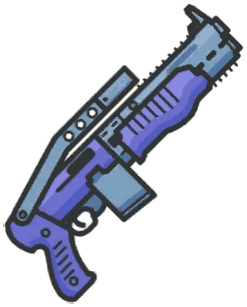 | **Tactical Shotgun** | Common–Rare | Vaulted 2020 (replaced by KSG); Weapons Race and Mystery Mode only. KSG without piercing. |
| 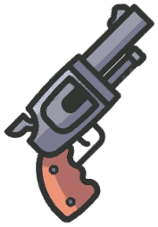 | **Revolver** | Legendary | Vaulted 2018; Weapons Race and Crystal Clash only. 25 damage, slow round-by-round reload. |

## Special weapons

| | Item | Rarity | Where | What it does |
|---|---|---|---|---|
| 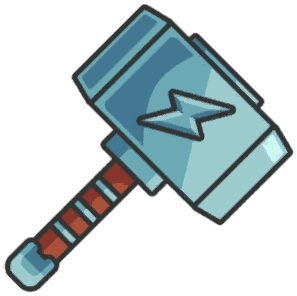 | **Thor's Hammer** | Mythic | Airdrop only | Thrown hammer: 45 direct / 25 splash, knocks players back. |
| 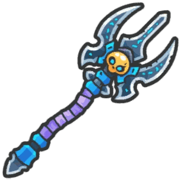 | **Trident of the Depths** | Mythic | Airdrop only | Thrown trident: 25 splash and pulls everyone in, like a Reverse Impulse. |
| 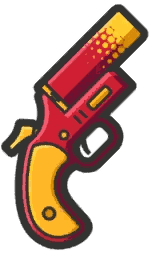 | **Airstrike Gun** | Legendary | Gold Chests | Flare that calls ~5 s of explosions (9–10 each, stacking); hurts you too. |
| 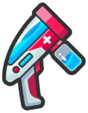 | **Healing Gun** | Epic | Crates, Gold Chests, Airdrops | Heals 12 health per shot (no shield); bounce shots off walls to heal yourself. 8 shots, no reload. |
| 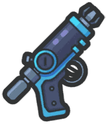 | **Grappling Hook** | Legendary | Crates, Gold Chests | Pulls you to the point you hit; 20 uses. |
| 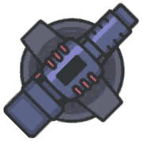 | **Turret** | Mythic | Vaulted; 50v50 Airdrops only | Thrown turret that fires at nearby enemies until destroyed. |

## Throwables

Lethal grenades hurt you but not your teammates. Stack is the amount you find / the most you can carry.

| | Throwable | Rarity | Stack | What it does |
|---|---|---|---|---|
|  | **Frag Grenade** ● | Common | 3 / 9 | 35–83 damage after a ~2 s fuse, light knockback; hurts you too. |
|  | **RGD-5 Grenade** | Common | 5 / 10 | 20–40 damage, explodes ~0.5 s after the throw; flies faster than a Frag. |
|  | **Sticky Bomb** | Epic | 3 / 9 | Flies straight, sticks to players or objects, 50 damage after ~2 s. |
|  | **Cactus Bomb** | Legendary | 3 / 9 | Bursts into bouncing thorns that hit anyone, including you. |
|  | **Gassy Grenade** | Legendary | 3 / 9 | Poison cloud, 15 damage per second; clouds stack. |
|  | **Incendiary Grenade** ● | Legendary | 3 / 9 | Ring of fire that burns, stacks like Gassy (added Aug 2024). |
|  | **Impulse Grenade** ● | Common | 3 / 9 | Pushes players away; no damage. |
|  | **Reverse Impulse Grenade** | Common | 3 / 9 | Pulls players to the blast; no damage. |
|  | **Smoke Grenade** | Common | 3 / 9 | Smoke cloud that hides players and items; no damage. |
|  | **Freeze Grenade** ● | Legendary | 3 / 3 | Slows, then freezes everyone in a small radius, you included. |
|  | **Snowman Grenade** ● | Common–Legendary | 3 / 6 | Builds a hollow box of breakable snowmen as cover. |
|  | **Healing Grenade** ● | Legendary | 2 / 6 | Heals you and teammates in the area, about +5 several times a second (added Jun 2024). |
|  | **Shuriken** | Legendary | 30 / 90 | Throws 5 stars in an arc, 20 damage each, ~2 volleys a second; short range. |
|  | **Snowball** | Common | 6 / 30 | 9 damage and slows the target ~5 s; found by breaking snowy trees at Lucky Lake. |

## Consumables, ammo and fists

These are not weapons, but their icons come from the same atlas and appear in the same inventory slots.

| | Item | Notes |
|---|---|---|
|  | **Bandage** | +15 health up to 75 (wiki: 2.2 s). |
|  | **Med Kit** | Heals to full health (wiki: 5 s). |
|  | **Small Shield Potion** | +25 shield up to 50 (2 s). |
|  | **Big Shield Potion** | +50 shield up to 100 (wiki: 5 s). |
|  | **Hybrid Potion** | +25 health and +25 shield over 10 s (2 s). |
|  | **Stimpack** | Legendary: +50% movement speed and fire rate for 10 s (1 s). |
|  | **Small ammo** | SMGs (not the Tommy Gun), pistols except the Deagle, VSS, Minigun, Flamethrower, Goo Gun, Rubber Gun. |
|  | **Medium ammo** | Assault rifles and the Tommy Gun. |
|  | **Large ammo** | Snipers except the VSS, Deagle, RPG, Grenade and Gift Launchers, Crossbow, XBow. |
|  | **Shotgun shells** | Shotguns. |
|  | **Fists** | Slot 1 melee. |

## In the game files but never released

The client's atlases also contain guns that never shipped. Names come from the wiki's leak pages and were matched by eye.

| | Name | Note |
|---|---|---|
|  | AN94 (unreleased) | Leaked burst AR, 21–22 damage. |
|  | AUG (unreleased) | Leaked burst AR, ~14 damage. |
|  | Grau (unreleased) | Leaked rainbow AR. |
|  | Bizon (unreleased) | Matches the wiki's Bizon leak image. |
|  | DMR (unreleased) | Matches the wiki's DMR image. |
|  | White Bolt? (unreleased) | Bolt sniper; name is a guess. |
|  | Laser Cannon (unreleased) | Leaked railgun, 24–97 damage. |
|  | Lunar RPG (unreleased) | Dragon-head launcher. |
|  | Freeze Turret (unreleased) | Ice version of the Turret. |

Twelve more sprites in the atlases match no wiki page. They may be old designs or test items. They are kept as `weapons/unidentified_NN.png` in case one turns up in a recording:

           

## How the assistant uses this

The catalog (`Sources/AssistantCore/Catalog.swift`) lists the 37 guns a prompt can name, with this ranking and the wiki's fire rate, reload and ammunition. A gun whose name is recognized gets a model ID such as `ar:rare:m4`; any other gun keeps a class ID such as `ar:rare` and counts as an average gun of its class.

- **Pickups** compare power: 101 minus the rank at the gun's best normal rarity, 3 points per rarity step from there. A gun replaces one of its role when it is worth at least 1.5 more. So a Legendary UMP (97) replaces an Epic Pump Shotgun (82), and a Rare M4 (89) replaces a Rare AK (76).
- **Range bands** still prefer shotguns up close, assault rifles at mid range and snipers far away. Within that, a better gun of a class wins: the UMP over the MP5, the Semi-Auto Sniper over a Bolt Mk. II one rarity higher.
- **Firing** uses each gun's own rate:
  - The Semi-Auto Sniper clicks four times a second.
  - The VSS, Hunting Rifle and the automatic pistols are held down.
  - The Dragunov reloads after every shot.
- Pistols other than the Deagle fill the close-range slot; the Deagle fills the long one.
- Range, zoom and bullet speed stay class estimates, because the wiki only describes them in words.
- The Stimpack (+50% movement speed and fire rate for 10 s) is not in the catalog yet.
- The wiki's use times for the Big Shield (5 s), Med Kit (5 s) and Bandage (2.2 s) differ from the catalog's estimates (4 s, 6 s, 2.5 s). Measure them before changing anything.

## Sources

- [ZombsRoyale.io wiki: Weapons](https://zombsroyaleio.fandom.com/wiki/Weapons) (stats table) and the individual weapon pages
- [Consumables](https://zombsroyaleio.fandom.com/wiki/Consumables), [Mythics](https://zombsroyaleio.fandom.com/wiki/Mythics), [Strategies](https://zombsroyaleio.fandom.com/wiki/Strategies), [Update Chronicle](https://zombsroyaleio.fandom.com/wiki/Update_Chronicle)
- Sprites: [Weapon inventory 1](https://zombsroyaleio.fandom.com/wiki/File:Weapon_inventory_1.png) and [Weapon inventory 2](https://zombsroyaleio.fandom.com/wiki/File:Weapon_inventory_2.png), extracted with RenderDoc from the official client
- Game art © the ZombsRoyale.io developers; wiki text is CC BY-SA.
